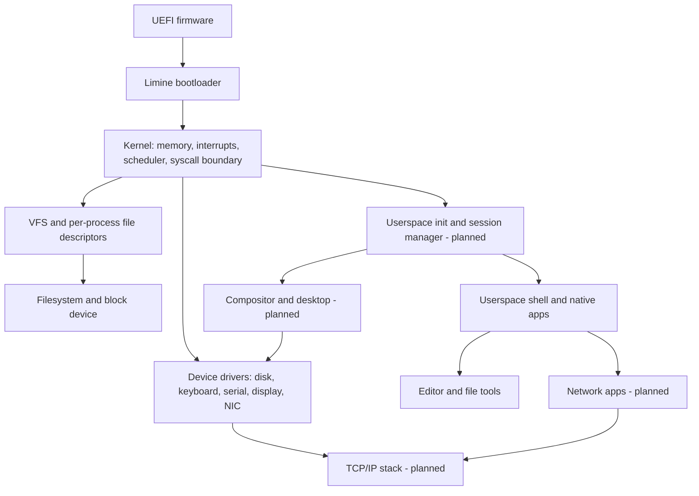

# AstraOS system architecture

## System boundary

The kernel owns privileged hardware access, isolation, scheduling, VM, system-call validation, and shared resource arbitration. User programs own policy and interaction: shell parsing, editing, services, network clients, and eventually the desktop. The kernel shell stays as a recovery interface until userspace startup, input routing, and failure restart are proven.

## Contracts by subsystem

| Subsystem | Owner and interface | Failure behavior / next contract |
| --- | --- | --- |
| Boot | Limine supplies memory map, framebuffer and entry state; kernel validates responses. | Missing required boot data yields a clear diagnostic and halt; UEFI boot is tested separately from BIOS. |
| Memory | PMM owns frames; VMM owns mappings; process loader owns user mappings. | Invalid user addresses return errors or terminate the offending process. Kernel allocation failures must not silently corrupt state. |
| Process | Scheduler owns run queue; process table owns PID, lifecycle, credentials, and descriptors. | Faulted or killed processes release resources; parent can observe exit. Timer preempts user code; kernel safe-point scheduling is the current limitation. |
| Syscall ABI | Architecture entry copies and validates user arguments before calling services. | Use bounded paths/buffers, documented negative error returns, and explicit ABI version before third-party apps are supported. |
| VFS | VFS owns path resolution and generic file operations; filesystem drivers own on-disk format. | Every open descriptor has one offset and close path. Permissions are checked at the syscall/VFS boundary; future work should make access modes explicit. |
| Block/storage | Driver owns device I/O; filesystem owns metadata ordering. | A write success must eventually mean a documented durability point. Add flush/sync semantics and power-failure tests before promising crash-safe saves. |
| Input/terminal | Driver owns keystrokes; terminal/session layer should own focus and line discipline. | A dead app must not consume keyboard input forever. Move primary interaction to userspace once restart/focus work. |
| Display | Driver owns framebuffer; future compositor owns windows and input focus. | Apps draw to isolated surfaces, not arbitrary framebuffer memory. Restart compositor without losing kernel control. |
| Network | NIC driver owns frames; TCP/IP stack owns protocols; native socket ABI owns app access. | Malformed packets, link loss, timeouts, and cancellation cannot block the whole OS. |
| Security | Kernel owns privilege boundaries, file access, and eventually capabilities. | Treat external disks, executables, and network input as untrusted; add userspace limits and explicit device access grants. |
| Diagnostics | Kernel serial log and counters first; user tools consume structured events later. | Faults include PID, reason, and recoverable state; avoid logging secrets. |

## Data paths

**Application launch:** shell parses command → spawn syscall validates path → VFS resolves ELF → loader creates private address space → scheduler runs process → exit/fault returns status → process resources are reaped. The kernel shell currently exercises this; userspace init and default shell are a later milestone.

**File save:** editor buffers text in user memory → file syscall validates path, buffer, permissions, and length → per-process descriptor tracks offset → VFS dispatches write → FAT16 changes data and metadata → block driver writes sectors → close and reboot → new boot remounts the same image → reopen/read compares bytes. Normal reboot persistence is the first gate. Crash consistency is a separate, stricter gate requiring flush semantics and fault injection.

**Future network request:** app socket call → kernel network API → stack → NIC; inbound frames traverse the reverse path after validation. The existing raw RTL8139 driver is only a starting device boundary, not application networking.

## Architecture evolution

1. Keep the current monolithic kernel while making module ownership and interfaces explicit. A microkernel rewrite would delay the first useful OS workflow without solving the present storage and app gaps.
2. Stabilize a small native syscall ABI and user runtime before porting a full C library. Add a compatibility layer only with tests for the actual subset implemented.
3. Move boot policy and the normal shell to a restartable userspace init/session process. Keep a limited kernel recovery shell.
4. Separate boot/interchange storage from persistent user data once durability requirements are clear. Do not treat FAT16 rename or close as a transaction.
5. Move window policy to a userspace compositor behind an IPC/surface contract. Add network and graphics as independent vertical slices with end-to-end tests.

## Observability and release rules

Each feature needs a serial-visible success or error, a focused QEMU test, and a user task that demonstrates it. Storage releases additionally need reboot and interrupted-I/O evidence. Hardware releases need a named machine, firmware mode, device list, and reproducible test notes. A capability appears in the README as “working” only when its acceptance gate passes.
